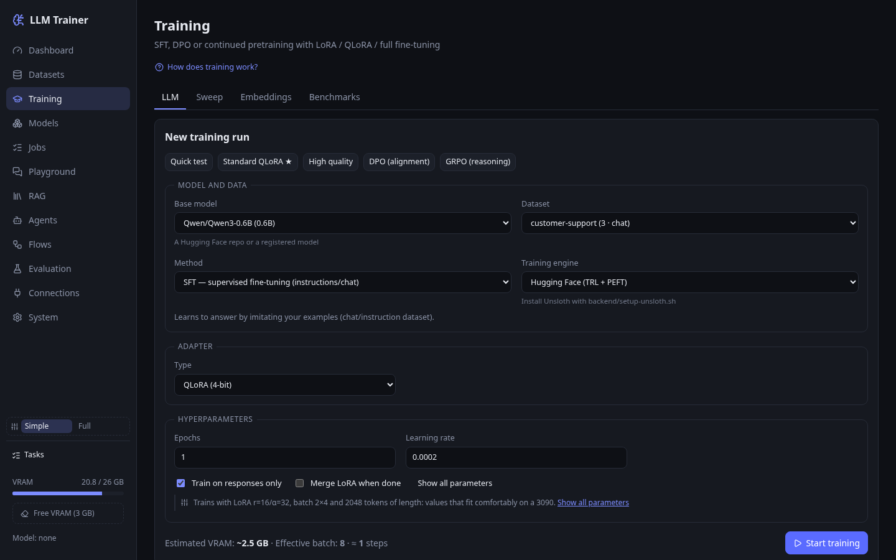
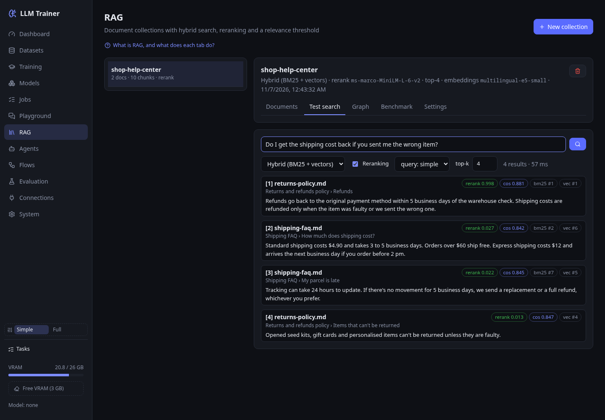
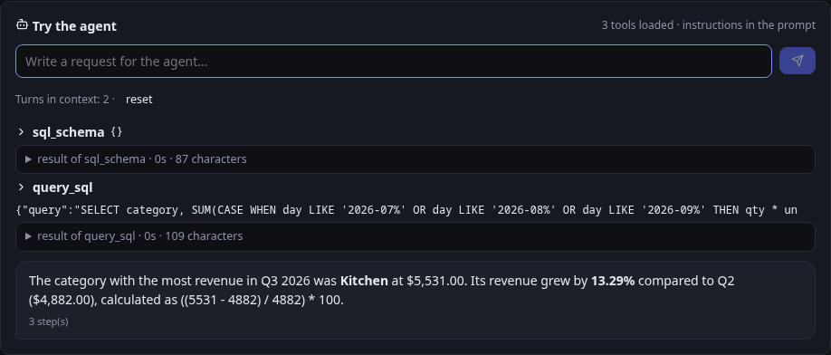

# LLM Trainer

A local web app for the whole small-model workflow on one GPU. You can:

- build a dataset;
- fine-tune a model (SFT, DPO, ORPO, KTO, GRPO);
- compare runs;
- export the result to GGUF for Ollama;
- put it to work with RAG, agents and visual flows;
- measure whether any of that actually helped.

Everything runs on your machine. External models (any OpenAI-compatible server, or
Anthropic) are optional helpers for tasks a small local model is bad at, such as judging
answers or generating synthetic data.

FastAPI + SQLite backend, React + TypeScript frontend. About 17k lines of Python and
TypeScript, with 114 backend tests.



| RAG: hybrid search with reranking | Agent with SQL tools, using a local Ollama model as helper |
| --- | --- |
|  |  |

The screenshots use made-up data: two help-center pages and a small SQLite sales table. The
agent runs on `qwen3:8b` through Ollama.

## Requirements

- **An NVIDIA GPU with CUDA** for training and for local inference with transformers.
  Developed on an RTX 3090 (24 GB). QLoRA on Qwen3-1.7B peaks at 5.7 GB (2.7 GB with
  Unsloth). See the [VRAM guide](#vram-guide) below. Retrieval (RAG) falls back to the CPU
  when there is no GPU.
- Linux, [uv](https://docs.astral.sh/uv/) and Node 20+.
- About 10 GB of disk for the Python environment (PyTorch with CUDA is most of it), plus
  whatever models you download.

```bash
./run.sh          # installs dependencies the first time, then serves http://127.0.0.1:8000
./run.sh dev      # development: API with reload on :8000 + Vite with HMR on :5173
```

Configuration is optional and lives in `.env` (see `.env.example`): a Hugging Face token
for gated models, the data folder, an API key for the OpenAI-compatible endpoint, and
backups.

### Optional engines

Each one installs from the **System** page with one click (no sudo), or by running its
script:

| Engine | Script | What it adds |
|---|---|---|
| Unsloth | `backend/setup-unsloth.sh` | Training about 2× faster with about half the VRAM. It gets its own environment (`.venv-unsloth`) because it pins its own transformers/TRL versions |
| vLLM | `backend/setup-vllm.sh` | Much faster generation: about 9× faster for GRPO and batch evaluation. Separate environment, about 10 GB |
| llama.cpp | `backend/setup-llamacpp.sh` | Export to GGUF (q4_k_m … f16) with a `Modelfile` for Ollama, and GGUF inference on the GPU through Vulkan, without the CUDA toolkit |

**Why llama.cpp isn't in the repository.** The script clones llama.cpp into `tools/`
(git-ignored) the first time you use it, and updates it on later runs. I chose this over
vendoring it or adding a git submodule:

- it's about 300 MB;
- only the GGUF features need it;
- llama.cpp moves fast, and its conversion script has to recognise new model
  architectures, so a pinned copy goes stale quickly.

The script also builds `llama-cpp-python` from source with Vulkan and `-march=native`,
because the prebuilt wheels assume AVX-512 and crash with `SIGILL` on CPUs that don't
have it.

For GPU inference of GGUF models it needs the Vulkan headers and `glslc`
(`sudo apt install libvulkan-dev glslc`). Without them, export still works and GGUF
inference runs on the CPU. To use a llama.cpp checkout you already have, set
`LLMT_LLAMA_CPP_DIR`.

## What's inside

| Page | What it does |
|---|---|
| **Datasets** | Import JSONL, JSON, CSV, Parquet or text, or a Hugging Face dataset (Alpaca, ShareGPT, OpenAI `messages`, preference pairs). Templates per use case explain how many examples you need and which method fits. Synthetic data from your documents or from a topic tree, with semantic deduplication and a quality filter run by a judge model |
| **Training** | SFT, DPO, ORPO, KTO, GRPO with verifiable rewards, and continued pretraining. QLoRA, LoRA or full fine-tuning, on the HF, Unsloth or vLLM engine. Live loss and reward curves. Hyperparameter sweeps (grid or random, ranked by eval loss). Fine-tuning of the RAG embedding model. Standard benchmarks (lm-evaluation-harness) to catch catastrophic forgetting |
| **Jobs** | History of every run. **Compare** overlays loss curves and adds a written verdict: who wins and by how much, whether the gap is noise, whether a run overfits, and whether the comparison is even fair (different data, different step counts, several settings changed at once). The verdict comes from fixed rules over your numbers, not from a model's opinion. Bulk cleanup can free disk space by deleting weights while keeping each run's curves and metrics |
| **Models** | Base models, your trained adapters, merged models and GGUFs, and embedding models, each with its size on disk and what uses it. Load in 16, 8 or 4-bit. LoRA merge and GGUF export. Three inference engines: transformers (with vision), llama.cpp (GGUF, with vision when an `mmproj` file sits next to the model) and vLLM |
| **Playground** | Streaming chat with saved conversations, image input, sampling controls, RAG with cited sources and A/B comparison |
| **RAG** | Ingests PDF (pymupdf4llm with OCR, or Docling), DOCX, PPTX, XLSX, HTML, Markdown, CSV and web pages or sitemaps. Hybrid BM25 + vector search with a reranker and a score threshold. Query modes: multi-query, HyDE, agentic and GraphRAG. Hierarchical summaries (RAPTOR), a knowledge graph with communities, and image descriptions from PDFs. A retrieval benchmark tells you whether a change helped |
| **Evaluation** | Saved question sets, so every model is measured against the same questions. A models × {no RAG, RAG} matrix. Metrics: judged correctness, similarity, keywords, and RAG faithfulness and context recall. Star ratings, and a judge calibration that correlates the judge with your own scores |
| **Agents** | Model + instructions + tools, with 18 built-in tools: RAG, knowledge graph, web search, read a URL, Wikipedia, weather, read-only SQL, HTTP with allowed domains, sandboxed Python, files, image description and any MCP server. Agent evaluation measures whether the agent picks the right tool. CrewAI `agents.yaml` import |
| **Flows** | Visual editor (React Flow) compiled to a **LangGraph** graph. Node types: model, tool, retrieval, agent, branch, human approval (you can edit the text before continuing), for-each, sub-flow and Python code. Rewind to any step, change a variable and continue without re-running the earlier steps. Exports to plain LangGraph code |
| **Connections** | The OpenAI-compatible API (`/v1/chat/completions`, `/v1/embeddings`) for Open WebUI, Continue or the OpenAI SDK. An **MCP server** with 12 tools for Claude Code, Cursor and other agents. External MCP servers for your agents, with a tested catalog (Hugging Face Hub, arXiv, local Whisper…). Triggers: webhooks, a Telegram bot and schedules |

Every page starts with a short "How does this work?" panel. A **simple mode** hides the
settings you almost never need to touch. It changes only what you see: the values sent
stay the same, and a footnote always says what is being applied.

## Design

```
backend/  FastAPI + SQLite (SQLModel)
  app/api/        REST endpoints (+ SSE for job progress, NDJSON for chat)
  app/services/   job queue, inference (one model in VRAM), rag, evaluation, synthetic data, flows, agents
  app/workers/    train.py / export.py / embed.py, run as separate processes
frontend/ React + Vite + TypeScript + Recharts + React Flow
data/     datasets, job outputs and logs, vector index, SQLite database (git-ignored)
```

- **Training runs in a child process.** When it ends, all of its VRAM goes back to the
  system, and a crash in CUDA or in a library can't take the API down. The worker writes
  `events.jsonl` and the API streams it to the browser over SSE.
- **One GPU queue.** Jobs run one at a time, and starting one unloads the playground model
  and the RAG models first. Inference keeps a single model loaded; comparing models loads
  them one after another.
- **Reproducibility.** Every training job saves a copy of its dataset next to its output,
  so editing the dataset later doesn't change what the run means.
- **Agent code runs in a sandbox.** The Python tool runs inside bubblewrap. It sees a
  read-only `/usr`, a temporary writable folder and, optionally, one read-only data folder.
  It has no network unless you enable it, and it has memory, CPU and file-size limits. If
  bubblewrap isn't installed, the tool still runs, but the reply and the System page say
  it's unsandboxed.
- **The app has no login.** It listens on `127.0.0.1` by default. Anything that reaches it
  from outside brings its own lock:
  - an API key for `/v1`;
  - a secret token for each webhook;
  - an allowlist of chats for the Telegram bot (with an empty list, the bot runs nothing).
- **Backups you can trust.** Daily backups cover the database, datasets and RAG indexes,
  but not model weights. The System page can **verify** a backup: it opens the copy in a
  temporary folder and counts its rows, without touching anything.

## Measured results (RTX 3090)

| Test | Result |
|---|---|
| QLoRA Qwen3-1.7B, 40 steps, seq 2048 | HF 73 s / 5.7 GB VRAM · **Unsloth 34 s / 2.7 GB** |
| GRPO Qwen3-0.6B, 30 steps (arithmetic) | HF 435 s · Unsloth 303 s · **vLLM 50 s**; reward 2.0 → 3.0 (max), reasoning format 50% → 100% |
| QLoRA Qwen3-8B / 14B (Unsloth) | 9.3 GB / 12.4 GB of VRAM |
| Batch evaluation, 20 questions | vLLM 17.7 s vs transformers 112 s |
| Catastrophic forgetting check | An overfit model (13 epochs on 6 examples) loses 12.6 points on Belebele (Spanish) |

Retrieval benchmark: 868 chunks from Wikipedia articles, a DOCX and a PDF, 15 questions.

| Mode | Hit@4 | MRR | Latency |
|---|---|---|---|
| Vectors (multilingual-e5-small) | 0.93 | 0.86 | 15 ms |
| BM25 | 0.73 | 0.64 | 16 ms |
| Hybrid | 0.93 | 0.83 | 17 ms |
| Hybrid + rerank (bge-reranker-v2-m3) | **1.00** | **0.95** | 329 ms |

Two experiments that didn't work, and are worth knowing about:

- **Generated questions per chunk.** I appended model-generated questions to each chunk,
  which made the vectors worse (MRR 0.79 → 0.74). Indexing the questions as separate
  vectors is neutral.
- **Fine-tuning the embedding model on synthetic questions.** It improved the synthetic
  held-out set (MRR 0.78 → 0.82) but made real questions worse (0.79 → 0.69), a
  distribution mismatch. The default is now a gentle fine-tune (1 epoch, lr 1e-5).

### VRAM guide

| Model size | QLoRA 4-bit | LoRA 16-bit |
|---|---|---|
| 0.6–4B | comfortable | comfortable |
| 7–8B | ~8–12 GB (seq 2048, batch 2) | ~20 GB |
| 12–14B | ~14–20 GB (batch 1) | doesn't fit in 24 GB |

Out of memory? Lower the batch size and raise gradient accumulation, shorten the maximum
length, or use QLoRA.

## Tests

```bash
cd backend && uv run pytest -q     # ~20 s, no GPU needed
```

The tests cover:

- dataset normalization;
- chunking;
- the HTML parser and BM25;
- GRPO rewards;
- the flow compiler;
- the security limits of the tools: read-only SQL, paths outside the allowed folder,
  allowed domains, and sandbox isolation;
- the cleanup safeguards;
- the evaluation metrics, which produce the numbers you make decisions with.

## Limitations

- Single user, single GPU: jobs are queued, not parallel.
- Training and local transformers inference need CUDA. AMD and Apple GPUs aren't
  supported, except for GGUF inference through Vulkan.

## License

MIT
